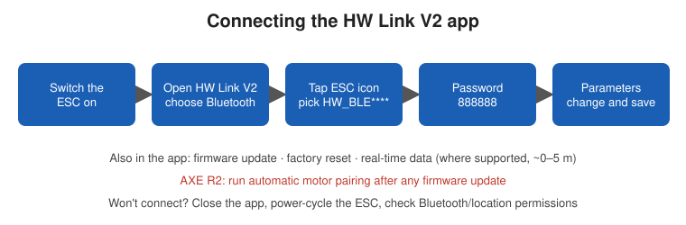
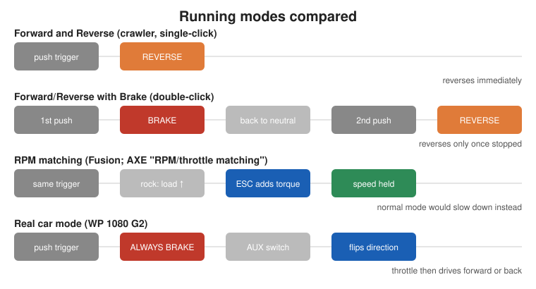
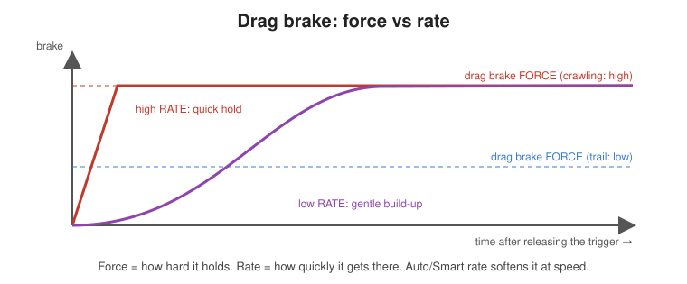
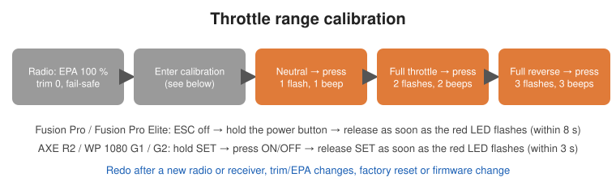

# XeRun AXE R2 (FOC crawler system)

A separate sensored brushless ESC and motor (AXE540, AXE540L or AXE550 R2) with FOC control and very
strong drag brake (up to 200 %).

**Programming: HW Link V2 app only, over the ESC's built-in Bluetooth.** The manual states: "The Axe ESC
is only adjustable using the HW Link App and a Bluetooth enabled smart phone." The **LED and LCD program
boxes are not supported** (some retail listings say otherwise; the manual is authoritative). See
[Programming Tools](programming-tools.md#hw-link-v2-app-bluetooth).

## Specifications

| ESC | XeRun AXE R2 (PN 30112102) |
|---|---|
| Continuous / peak current | 80 A / 480 A |
| Battery | 2–3S LiPo, 6–9 cell NiMH |
| BEC | 6.0 / 7.4 V switchable, 6 A continuous |
| Size / weight | 47.4 × 36.2 × 26.5 mm / 108 g (with input wires) |
| Motors | **AXE R2 series only** |
| Connectors | None fitted |

| Motor | kV | No-load current | Length | Weight | Combo PN |
|---|---|---|---|---|---|
| AXE540 R2 | 2300 | 2.5 A | 49.8 mm | 185 g | 38020318 |
| AXE540L R2 | 1400 | 1.7 A | 57.8 mm | 232 g | 38020311 |
| AXE540L R2 | 2100 | 2.7 A | 57.8 mm | 233 g | 38020312 |
| AXE540L R2 | 2800 | 3.6 A | 57.8 mm | 234 g | 38020313 |
| AXE550 R2 | 3300 | 4.7 A | 63.8 mm | 268 g | 38020314 |

All 36 mm diameter, 4-pole, 2–3S. A cooling fan is recommended with the 550 motor.

## Programmable items (HW Link V2 app)

**Bold** is the factory default. There are no LED box codes for this ESC.

| # | Setting | Options |
|---|---|---|
| 1 | Running mode | **Forward and Reverse** · Forward/Reverse with Brake |
| 2 | RPM/Throttle matching | Disabled · Low · **Intermediate** · High |
| 3 | Cutoff voltage | Disabled · Low (3.0 V/cell) · **Intermediate (3.2 V)** · High (3.4 V) |
| 4 | BEC voltage | **6.0 V** · 7.4 V |
| 5 | Motor rotation | **CCW** · CW |
| 6 | Max. forward force | 25 % · 37.5 % · 50 % · 62.5 % · 75 % · 87.5 % · **100 %** |
| 7 | Punch | 1–15 (**8**) |
| 8 | Neutral range | 3–15 % (**8 %**) |
| 9 | RPM decrease rate (only when RPM matching is Disabled) | **Level 1**–9 |
| 10 | Max. reverse force | 25 % · 37.5 % · 50 % · 62.5 % · 75 % · 87.5 % · 100 % (no default marked in the manual) |
| 11 | Max. brake force | 10–200 % (**100 %**) |
| 12 | Drag brake force | 0–200 % (**80 %**) |
| 13 | Smart drag brake rate | Disabled · **Enabled** |
| 14 | Drag brake rate | 1–15 (**8**) |
| 15 | Turbo timing | 0–10° (**0°**) |
| 16 | Turbo delay | **Instant** · 0.05–1.0 s |

Notes from the manual:
- **RPM/throttle matching** is adjustable in strength: higher = speed changes less with load.
- **Cutoff:** output drops to 50 % within 3 s and cuts about 30 s later.
- **Drag brake** above 100 % is very strong — it uses more power and makes more heat.
- **Smart drag brake rate** slows the drag brake build-up at higher speed to avoid flips.
- **Punch** at high levels needs a battery that delivers current quickly; stuttering starts mean reduce
  punch or gearing.

## Settings: what they do, with trail and crawling recommendations

Each setting, what it does, and starting points for **trail** (scale driving, mixed terrain, some speed) and **crawling** (slow, technical rock work). LED codes are *item → option*. Change one setting at a time and test.

| Item | Setting | What it does | Trail | Crawling |
|---|---|---|---|---|
| 1 | Running mode | Forward and Reverse reverses instantly; Fwd/Rev with Brake needs a double push | Forward and Reverse | Forward and Reverse |
| 2 | RPM/throttle matching | How strongly the ESC adds torque to hold speed under load; Disabled = ordinary feel | **Disabled–Low** for a natural, coasting feel | **Intermediate–High** for steady speed over rocks |
| 3 | Cutoff voltage | Low-voltage protection (3.0/3.2/3.4 V per cell) | Intermediate (LiPo); Disabled (NiMH) | Intermediate (LiPo); Disabled (NiMH) |
| 4 | BEC voltage | Voltage to receiver and servo; 7.4 V only holds on 3S | 6.0 V; 7.4 V for an HV servo on 3S | 7.4 V with an HV servo on 3S |
| 5 | Motor rotation | Motor direction for your chassis | Change if needed | Change if needed |
| 6 | Max. forward force | Caps full throttle; lower gives finer trigger control | 62.5–75 % | 75–100 % |
| 7 | Punch | How aggressively the motor starts (1 soft – 15 aggressive) | 6–9 | 4–8; lower on slick rock |
| 8 | Neutral range | Dead band around neutral (3–15 %) | 8 % | 8 %; raise if drag brake is inconsistent |
| 9 | RPM decrease rate | How fast RPM falls when you lift off (only with RPM matching Disabled) | Level 1–3 to coast | No effect with RPM matching on |
| 10 | Max. reverse force | Caps reverse power | 50–75 % | 75–100 % |
| 11 | Max. brake force | Strength at full brake (10–200 %) | 80–100 % | 100 %; up to 150 % for very steep descents |
| 12 | Drag brake force | Brake at neutral (0–200 %); more holds better but uses power and heats | 30–60 % so it rolls a little | 100–150 % (up to 200 % for comp) |
| 13 | Smart drag brake rate | Softens drag brake build-up at higher speed to avoid flips | Enabled | Enabled |
| 14 | Drag brake rate | How quickly drag brake builds up (1 soft – 15 abrupt) | 4–6 | 6–10 |
| 15 | Turbo timing | Extra timing at full throttle for top speed | 0° | 0° |
| 16 | Turbo delay | Delay before turbo engages | Instant (no effect at 0°) | Instant (no effect at 0°) |

Set these in the HW Link V2 app — there are no LED box codes for this ESC.

Pick the motor for the job: **1400 kV** for slow, torquey technical crawling; **2100/2300 kV** for general crawling and trail; **2800/3300 kV** for faster trail and bounce.

## Setting up

1. **Motor wiring:** A/B/C ESC wires to A/B/C motor wires **in order**; sensor cable aligned by the
   arrow and screwed tight (water can get in otherwise). Use AXE R2 motors only.
2. **Receiver:** throttle cable to the throttle channel (red wire = BEC power).
3. **Battery:** observe polarity.
4. **Calibrate the throttle range** (hold SET, press ON/OFF) — see
   [Programming Tools](programming-tools.md#throttle-calibration-all-of-these-escs).
5. **Program** with HW Link V2: Bluetooth device **HW_BLE****, password **888888**.
6. **Factory reset:** hold SET for over 3 s at neutral (also resets the Bluetooth name and password), or
   app → Parameters → Factory Reset. Recalibrate afterwards.
7. **Automatic motor pairing** — required after a **firmware update**, a loose end plate, a hard impact
   or abnormal heat: unplug the throttle cable from the receiver, remove the pinion, switch on, hold SET
   for 3 s until green flashes, release; the motor runs and stops; reconnect and restart.

## LED codes

| LED | Meaning |
|---|---|
| Red flashing at start | No throttle signal or neutral mismatch |
| Green flashes N times | N-cell LiPo |
| Red solid driving forward/braking | Normal; green also solid at full throttle/brake (100 %) |
| Red single flash repeating | Low-voltage cutoff |
| Green single flash repeating | ESC overheat |
| Green double flash repeating | Motor overheat |
| Red + green double flash repeating | **Sensor problem** — check the sensor cable |

## Sources

- Hobbywing — [XeRun AXE R2 brushless system user manual (May 2023)](https://www.hobbywing.com/en/uploads/file/20230602/a10547ad7f0c7973ea4e9ca18f7a1083.pdf); parameter table and defaults read from it
- Hobbywing — [XeRun AXE R2 ESC](https://www.hobbywing.com/en/products/xerun-axe-r2-esc43), [AXE R2 combo](https://www.hobbywing.com/en/products/xerun-axe-r2-combo158)
- manuals.plus — [AXE R2 brushless system manual](https://manuals.plus/hobbywing/xerun-axe-r2-brushless-system-manual)
- Hobbies Direct — [AXE R2 listing (LED box not supported)](https://hobbiesdirect.com.au/Hobbywing-XeRun-AXE-R2-FOC-Sensored-Brushless-ESC-30112102)
- Hobbywing Direct support — [AXE programming via HW Link](https://support.hobbywingdirect.com/hc/article_attachments/32137581111187)
