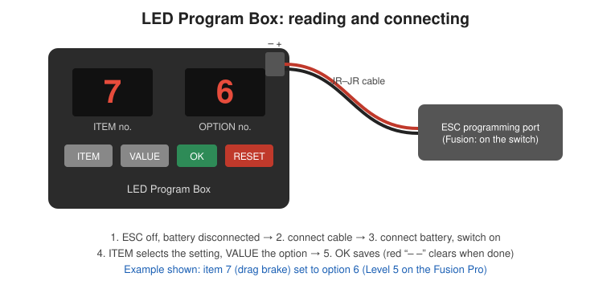
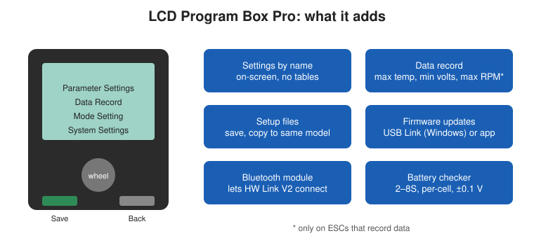
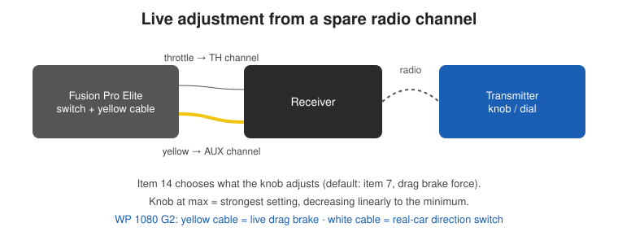
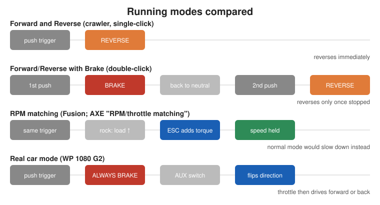
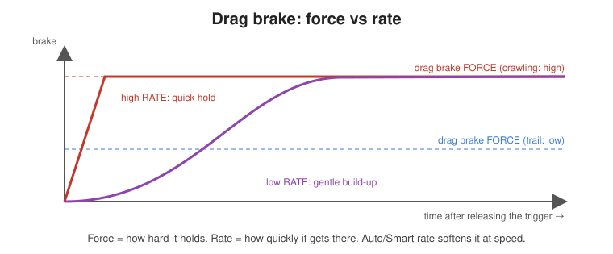
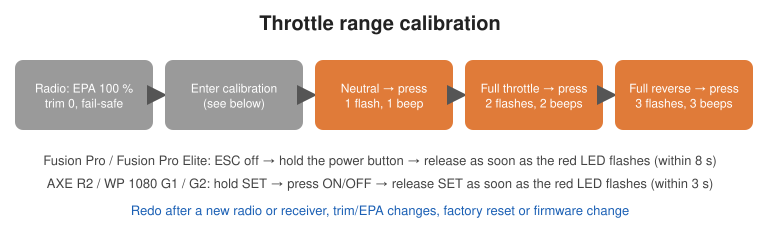

# QuicRun Fusion Pro Elite (2300 kV, 2-in-1 crawler system)

A shorter, lighter successor to the Fusion Pro: sensored brushless motor and ESC in one can, FOC
control, up to 4S, hybrid running modes and live adjustment from a spare radio channel.

Programming: **LED Program Box** or **LCD Program Box Pro / G2** (via the 3-pin port on the power
switch). See [Programming Tools](programming-tools.md) and [Settings Explained](settings-explained.md).

## Specifications

| | |
|---|---|
| Continuous / peak current | 50 A / 150 A |
| Battery | 2–4S LiPo, 6–12 cell NiMH |
| Motor | 2300 kV, 4-pole, sensored, FOC |
| BEC | 6.0 / 7.4 / 8.4 V, 5 A continuous (switch mode) |
| Size / weight | 37 mm dia × 48.5 mm long / 178.5 g with wires and connectors |
| Shaft | 3.175 mm, 16 mm exposed |
| Mounting | 6 × M3, holes 5 mm deep |
| Waterproofing | IP67 |
| Programming port | Separate port on the power switch |
| Extra cable | Yellow signal cable for live adjustment from a spare (AUX) channel |

Compared with the **Fusion Pro**: 9.5 mm shorter and ~30 g lighter, up to 4S, 8.4 V BEC option, hybrid
modes, AUX channel function and LCD box support — but lower current rating (50 A vs 60 A) and BEC
(5 A vs 6 A).

## Programmable items and LED box codes

**Bold** is the factory default. LED code = *item → option*.

| Item | Setting | Options (option number) | Default (LED code) |
|---|---|---|---|
| 1 | Running mode | **1 Forward and Reverse (RPM matching)** · 2 Forward/Reverse with Brake (normal) · 3 Forward and Reverse (normal) · 4 Hybrid-RPM matching · 5 Hybrid-Normal | 1 → 1 |
| 2 | LiPo cells | **1 Auto** · 2 2S · 3 3S · 4 4S | 2 → 1 |
| 3 | Cutoff voltage | 1 Disabled · 2 Low (3.0 V/cell) · **3 Medium (3.25 V/cell)** · 4 High (3.5 V/cell) | 3 → 3 |
| 4 | Thermal protection | **1 105 °C** · 2 125 °C | 4 → 1 |
| 5 | Motor rotation | **1 CCW** · 2 CW | 5 → 1 |
| 6 | BEC voltage | **1 6.0 V** · 2 7.4 V · 3 8.4 V | 6 → 1 |
| 7 | Drag brake force | 1 Disabled · 2 L1 · 3 L2 · 4 L3 · 5 L4 · **6 L5** · 7 L6 · 8 L7 · 9 L8 | 7 → 6 |
| 8 | Drag brake rate | **1 Auto** · 2–9 = Level 1–8 | 8 → 1 |
| 9 | Max. reverse force | 1 25 % · 2 50 % · 3 75 % · **4 100 %** | 9 → 4 |
| 10 | Max. brake force | 1 10 % · 2 20 % · 3 30 % · 4 40 % · 5 50 % · **6 60 %** · 7 70 % · 8 85 % · 9 100 % | 10 → 6 |
| 11 | RPM decrease rate (normal modes only) | 1–9 = Level 1–9, **1 = Level 1** | 11 → 1 |
| 12 | Punch | 1–9 = Level 1–9, **5 = Level 5** | 12 → 5 |
| 13 | Neutral range | 1 4 % · 2 6 % · **3 8 %** · 4 10 % · 5 12 % | 13 → 3 |
| 14 | AUX CH function | 1 Item 1 (running mode) · **2 Item 7 (drag brake force)** · 3 Item 8 (drag brake rate) · 4 Item 9 (max. reverse) · 5 Item 10 (max. brake) | 14 → 2 |

Notes from the manual:
- **Low-voltage cutoff:** output drops to 50 %, then cuts after 10 seconds.
- **Thermal:** output drops to 50 %, then shuts down after about 40 seconds.
- **Drag brake rate Auto** lowers the rate when current draw is high (at speed), to avoid flips or
  drivetrain damage, while staying precise at low speed.
- **BEC 7.4/8.4 V on 2S** can't hold its voltage — it follows the battery. Use 3S/4S for HV settings.
- With **AUX = Item 1**, the knob switches only between the RPM-matching modes; options 2, 4 and 5
  don't apply.

## Live adjustment from the transmitter (AUX)

1. Plug the **yellow signal cable** into a spare receiver channel (a knob, dial or 3-position switch).
2. Choose the setting with **item 14** (default: drag brake force).
3. Turn the knob: highest signal = strongest setting, decreasing linearly to the lowest.

Popular use: drag brake on a dial — low for trail driving, high for steep climbs and descents.

## Settings: what they do, with trail and crawling recommendations

Each setting, what it does, and starting points for **trail** (scale driving, mixed terrain, some speed) and **crawling** (slow, technical rock work). LED codes are *item → option*. Change one setting at a time and test.

| Item | Setting | What it does | Trail | Crawling |
|---|---|---|---|---|
| 1 | Running mode | How the trigger behaves: RPM matching holds speed under load; normal behaves like an ordinary ESC; Fwd/Rev with Brake needs a double push to reverse; Hybrid modes link the mode to the drag brake setting | **1 → 3** Forward and Reverse (normal), or **1 → 4** Hybrid-RPM with drag brake on a knob | **1 → 1** RPM matching: steady speed up and over rocks |
| 2 | LiPo cells | Tells the ESC the pack size so the cutoff works; Auto can misread a flat 3S as a full 2S | **2 → 2/3/4** set to your pack | **2 → 2/3/4** set to your pack |
| 3 | Cutoff voltage | Cuts power before the LiPo is over-discharged (Low 3.0, Medium 3.25, High 3.5 V/cell) | **3 → 3** Medium (LiPo); **3 → 1** for NiMH | **3 → 3** Medium (LiPo); **3 → 1** for NiMH |
| 4 | Thermal protection | Temperature at which power is cut to protect the system | **4 → 1** 105 °C | **4 → 1** 105 °C |
| 5 | Motor rotation | Motor direction for your chassis | Change only if forward throttle drives backwards | Same |
| 6 | BEC voltage | Voltage to receiver and servo (6.0/7.4/8.4 V); never above their rating; 7.4/8.4 V only hold on 3S/4S | **6 → 1** 6.0 V; **6 → 2** for an HV servo on 3S | **6 → 2–3** with an HV servo rated for it, on 3S/4S |
| 7 | Drag brake force | Brake applied automatically at neutral; holds the truck on slopes | **7 → 3–4** (L2–L3) so it coasts a little | **7 → 7–9** (L6–L8) to hold on climbs and descents |
| 8 | Drag brake rate | How quickly drag brake builds up; **Auto** softens it at high current (speed) and keeps it precise at low speed | **8 → 1** Auto | **8 → 1** Auto, or **5–7** (L4–L6) for a fixed, firmer hold |
| 9 | Max. reverse force | Caps reverse power | **9 → 2–3** (50–75 %) | **9 → 4** (100 %) for backing off ledges |
| 10 | Max. brake force | Strength at full brake (trigger in reverse zone, double-click mode) | **10 → 5–6** (50–60 %) | **10 → 6** (60 %); **7–9** for very steep descents |
| 11 | RPM decrease rate | How fast RPM falls when you lift off (normal modes only) | **11 → 1–3** to coast | No effect in RPM matching |
| 12 | Punch | How aggressively the motor starts | **12 → 4–6** | **12 → 3–5** less wheel spin on slick rock |
| 13 | Neutral range | Dead band around neutral | **13 → 3** (8 %) | **13 → 3**; **4** (10 %) if it creeps at neutral |
| 14 | AUX CH function | Which setting a spare radio channel (yellow cable) adjusts live | **14 → 2** drag brake on a knob: low for trail, high when it gets steep | **14 → 2** drag brake, or **14 → 3** drag brake rate |

**Hybrid on a knob:** set **1 → 4** (Hybrid-RPM) and **14 → 2**. With the drag-brake knob at zero the system behaves as Forward/Reverse with Brake (coasting, double-click reverse); any drag brake gives RPM-matching crawler behaviour — one dial switches between trail and crawl.

## Setting up

1. **Mount** with 6 × M3 screws no deeper than 5 mm into the motor.
2. **Receiver:** throttle cable to the throttle channel (red wire = BEC power). Yellow cable to a spare
   channel if you want live adjustment.
3. **Battery:** observe polarity.
4. **Calibrate the throttle range** — see [Programming Tools](programming-tools.md#throttle-calibration-all-of-these-escs).
5. **Program** with the LED or LCD box via the 3-pin port on the switch.
6. **Factory reset:** LED box → **RESET** → **OK**, or LCD box → Parameter Settings → Reset Parameters.
7. **Automatic motor pairing** (after a hard impact, abnormal heat or abnormal power): unplug the
   throttle cable from the receiver, separate the motor from the gearbox, then with the system off
   press and hold the power button — red flashes, then green after about 8 s — release; the system
   pairs (motor doesn't turn), restarts and reports the cell count. Recalibrate the throttle.

## LED codes

| LED | Meaning |
|---|---|
| Red solid after power-on | Normal |
| Red flashing fast | No throttle signal or neutral mismatch — recalibrate |
| Green flashes N times at start | N-cell LiPo detected |
| Green off at neutral; flashing when driving; solid at full throttle | Normal operation |
| Red single flash repeating | Low-voltage protection |
| Green single flash repeating | Overheat protection |

## Sources

- Hobbywing — [QuicRun Fusion Pro Elite user manual (Aug 2025)](https://www.hobbywing.com/en/uploads/file/20250904/2a2993458d16c7112d1e6c62668f0460.pdf); parameter table and defaults read from it
- Hobbywing — [QuicRun Fusion Pro Elite product page](https://www.hobbywing.com/en/products/quicrun-fusion-pro-elite), [news release](https://www.hobbywing.com/en/news/info/77)
- manuals.plus — [Fusion Pro Elite manual](https://manuals.plus/m/9b1259a99f0e8a715aad347774d93e88727cbc21438918c0505881c6c56f58cd)
- Retailer listings — [Power Hobby](https://www.powerhobby.com/collections/all/products/hobbywing-hwi30120500-quicrun-fusion-pro-elite-2-in-1-foc-system), [Boom Racing](https://www.boomracing.com/hobbywing-quicrun-fusion-pro-elite-for-crawler-2300kv-245341)
- OpenELAB — [Common Hobbywing ESC settings](https://openelab.io/it/blogs/learn/what-are-common-hobbywing-esc-settings)
