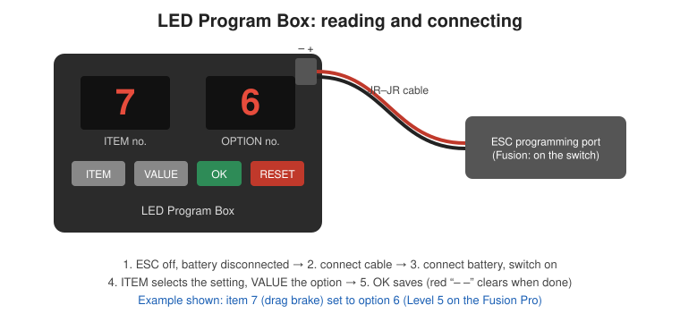
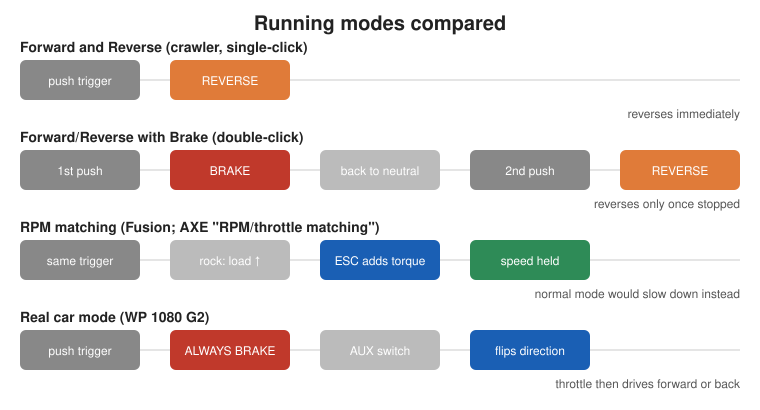
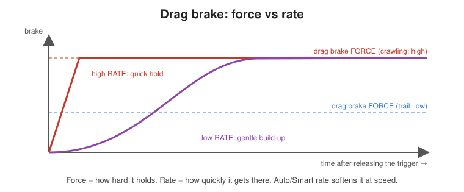
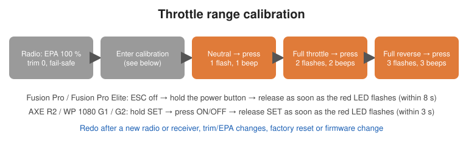

# QuicRun Fusion Pro (2300 kV, 2-in-1 crawler system)

A sensored brushless motor and ESC in one can, with FOC control, for 1/10 crawlers.

Programming: **LED Program Box** (via the 3-pin port on the power switch). The calibration steps use the
switch's power button. See [Programming Tools](programming-tools.md) and
[Settings Explained](settings-explained.md).

## Specifications

| | |
|---|---|
| Continuous / peak current | 60 A / 200 A |
| Battery | 2–3S LiPo, 6–9 cell NiMH |
| Motor | 2300 kV, 4-pole, sensored, FOC |
| BEC | 6.0 / 7.4 V switchable, 6 A continuous (switch mode) |
| Size / weight | 37 mm dia × 58 mm long / 209 g with wires and connectors |
| Shaft | 3.175 mm, 16 mm exposed |
| Programming port | Separate port on the power switch |
| Protections | Low voltage, overheat, throttle signal loss, motor lock-up |

## Programmable items and LED box codes

The **LED box code** is *item number → option number*. **Bold** is the factory default.

| Item | Setting | Options (option number) | Default (LED code) |
|---|---|---|---|
| 1 | Running mode | **1 Forward and Reverse — RPM matching (constant speed)** · 2 Forward/Reverse with Brake (normal) · 3 Forward and Reverse (normal) | 1 → 1 |
| 2 | LiPo cells | **1 Auto** · 2 2S · 3 3S | 2 → 1 |
| 3 | Cutoff voltage | 1 Disabled · 2 Low (3.0 V/cell) · **3 Medium (3.25 V/cell)** · 4 High (3.5 V/cell) | 3 → 3 |
| 4 | Thermal protection | **1 105 °C** · 2 125 °C | 4 → 1 |
| 5 | Motor rotation | **1 CCW** · 2 CW | 5 → 1 |
| 6 | BEC voltage | **1 6.0 V** · 2 7.4 V | 6 → 1 |
| 7 | Drag brake force | 1 Disabled · 2 L1 · 3 L2 · 4 L3 · 5 L4 · **6 L5** · 7 L6 · 8 L7 · 9 L8 | 7 → 6 |
| 8 | Drag brake rate | 1–9 = Level 1–9, **5 = Level 5** | 8 → 5 |
| 9 | Max. reverse force | 1 25 % · 2 50 % · 3 75 % · **4 100 %** | 9 → 4 |
| 10 | Max. brake force | 1 10 % · 2 20 % · 3 30 % · 4 40 % · 5 50 % · **6 60 %** · 7 70 % · 8 85 % · 9 100 % | 10 → 6 |
| 11 | RPM decrease rate (normal modes only) | 1–9 = Level 1–9, **1 = Level 1** | 11 → 1 |
| 12 | Punch (start mode) | 1–9 = Level 1–9, **5 = Level 5** | 12 → 5 |
| 13 | Neutral range | 1 4 % · 2 6 % · **3 8 %** · 4 10 % · 5 12 % | 13 → 3 |

Low-voltage cutoff on this model: output drops to 50 %, then cuts after 30 seconds.

## Settings: what they do, with trail and crawling recommendations

Each setting, what it does, and starting points for **trail** (scale driving, mixed terrain, some speed) and **crawling** (slow, technical rock work). LED codes are *item → option*. Change one setting at a time and test.

| Item | Setting | What it does | Trail | Crawling |
|---|---|---|---|---|
| 1 | Running mode | How the trigger behaves: RPM matching holds speed under load; normal behaves like an ordinary ESC; Fwd/Rev with Brake needs a double push to reverse | **1 → 3** Forward and Reverse (normal) for a natural, coasting feel | **1 → 1** RPM matching: steady speed up and over rocks |
| 2 | LiPo cells | Tells the ESC the pack size so the cutoff works; Auto can misread a flat 3S as a full 2S | **2 → 2/3** set to your pack | **2 → 2/3** set to your pack |
| 3 | Cutoff voltage | Cuts power before the LiPo is over-discharged (Low 3.0, Medium 3.25, High 3.5 V/cell) | **3 → 3** Medium (LiPo); **3 → 1** for NiMH | **3 → 3** Medium (LiPo); **3 → 1** for NiMH |
| 4 | Thermal protection | Temperature at which power is cut to protect the system | **4 → 1** 105 °C | **4 → 1** 105 °C |
| 5 | Motor rotation | Motor direction for your chassis | Change only if forward throttle drives backwards | Same |
| 6 | BEC voltage | Voltage to receiver and servo; never above their rating; 7.4 V only holds on 3S | **6 → 1** 6.0 V; **6 → 2** for an HV servo on 3S | **6 → 2** 7.4 V with an HV servo on 3S for more steering torque |
| 7 | Drag brake force | Brake applied automatically at neutral; holds the truck on slopes | **7 → 3–4** (L2–L3) so it coasts a little | **7 → 7–9** (L6–L8) to hold on climbs and descents |
| 8 | Drag brake rate | How quickly drag brake builds up after you release the trigger | **8 → 3–4** soft stops at speed | **8 → 4–6** quick but controlled hold |
| 9 | Max. reverse force | Caps reverse power | **9 → 2–3** (50–75 %) | **9 → 4** (100 %) for backing off ledges |
| 10 | Max. brake force | Strength at full brake (trigger in reverse zone, double-click mode) | **10 → 5–6** (50–60 %) | **10 → 6** (60 %); **7–9** for very steep descents |
| 11 | RPM decrease rate | How fast RPM falls when you lift off (normal modes only) | **11 → 1–3** to coast | No effect in RPM matching |
| 12 | Punch | How aggressively the motor starts | **12 → 4–6** | **12 → 3–5** less wheel spin on slick rock |
| 13 | Neutral range | Dead band around neutral | **13 → 3** (8 %) | **13 → 3**; **4** (10 %) if it creeps at neutral |

**Steep descents:** RPM matching, drag brake **7 → 9**, rate **8 → 3–5**, reverse **9 → 3**.

## Setting up

1. **Mount** with M3 screws that don't go deeper than the motor's holes allow.
2. **Receiver:** throttle cable into the throttle channel. The red wire supplies BEC power — don't power
   the receiver separately (or unpin the red wire if you must).
3. **Battery:** observe polarity — reverse polarity damages the system and isn't covered by warranty.
4. **Calibrate the throttle range** — see [Programming Tools](programming-tools.md#throttle-calibration-all-of-these-escs).
5. **Program** with the LED box: connect to the switch's 3-pin port with a JR–JR cable, then power on.
6. **Factory reset:** LED box → **RESET** → **OK**.
7. **Disconnect the battery after use** — the system draws a small current even when switched off.

## LED codes

| LED | Meaning |
|---|---|
| Red solid after power-on | Normal |
| Red flashing fast | No throttle signal, or neutral doesn't match — recalibrate |
| Green flashes N times at start | N-cell LiPo detected |
| Red single flash repeating | Low-voltage protection |
| Green single flash repeating | Overheat protection |

## Sources

- Hobbywing — [QuicRun Fusion Pro user manual (Chinese, Jan 2024)](https://www.hobbywing.com/uploads/file/20240229/3ffcb6d102dd77fc25d3b6fc164b447a.pdf); parameter table and defaults read from it
- Eurorc — [Fusion Pro 2300 kV manual](https://www.eurorc.com/files/manuals/hobbywing/Manual_HW-SMC317DUL_QUICRUN_Fusion_Pro_for_Crawler-2300KV_540spec.pdf)
- manuals.plus — [QuicRun Fusion Pro user manual](https://manuals.plus/hobbywing/quicrun-fusion-pro-manual)
- Hobbywing Direct — [QuicRun Fusion Pro](https://hobbywingdirect.com/collections/quicrun-fusion-pro)
