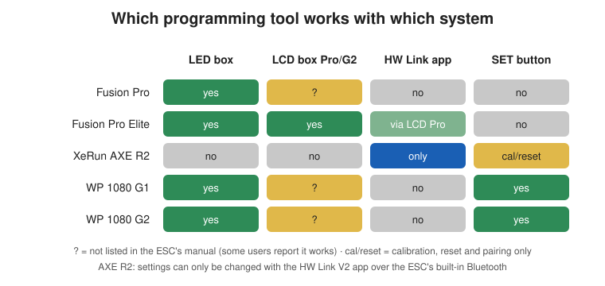
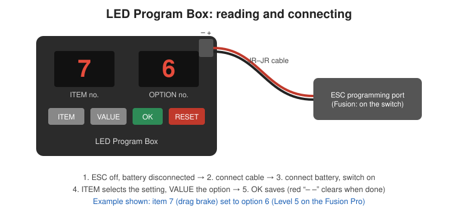
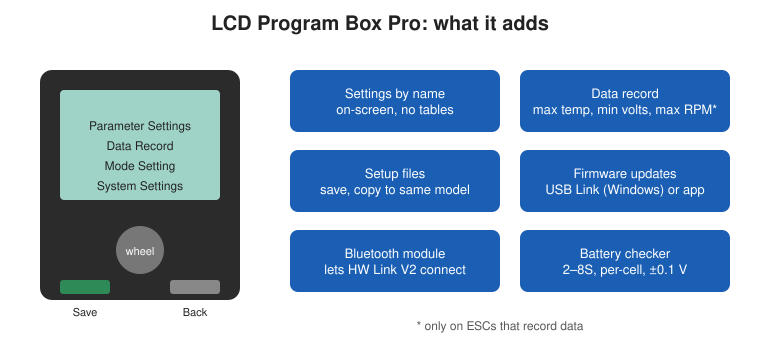
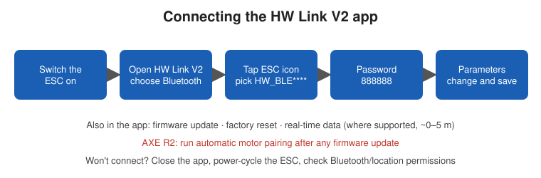
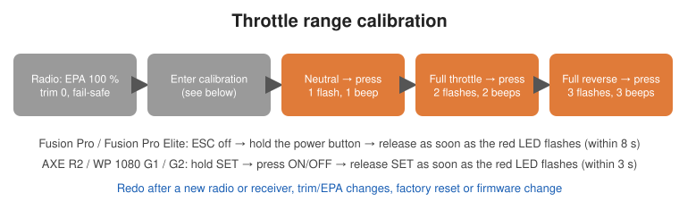

# Programming Tools: LED Program Box, LCD Program Box and HW Link App

Hobbywing ESCs can be set up in four ways. Which ones work depends on the ESC:

| | LED Program Box | LCD Program Box Pro / G2 | HW Link V2 app (Bluetooth) | SET button on the ESC |
|---|---|---|---|---|
| **QuicRun Fusion Pro** | ✅ (manual) | Not listed in the manual | ❌ | ❌ (power button only for calibration) |
| **QuicRun Fusion Pro Elite** | ✅ | ✅ Pro and G2 | Via LCD Box Pro's Bluetooth* | ❌ |
| **XeRun AXE R2** | ❌ | ❌ | ✅ **only method** — built-in Bluetooth | Calibration, reset and motor pairing only |
| **QuicRun WP 1080 G1** | ✅ (LED card included in the box) | Not listed in the manual | ❌ | ✅ |
| **QuicRun WP 1080 G2** | ✅ (LED card sold separately) | Not listed in the manual | ❌ | ✅ |

\* The LCD Program Box Pro can act as an OTA Bluetooth module so the app can program ESCs that the box
supports. This is from the box's manual, not the Fusion Pro Elite manual — test before relying on it.

"Not listed" means the ESC's own manual doesn't mention it. Some users report it works; Hobbywing's
advice is to check the ESC's manual or ask Hobbywing.

---

## LED Program Box (part 30501003)

A small, cheap field tool with two LED digit displays and four buttons. Best for quick changes at the
trail.

| Spec | Value |
|---|---|
| Working voltage | 4.8–8.4 V (powered by the ESC's programming port on all the ESCs in this guide) |
| Size / weight | 88 × 58 × 14 mm / 40 g |
| Works with | XeRun, EzRun and QuicRun car ESCs, Platinum V1/V2 and FlyFun V5 aircraft ESCs, SeaKing boat ESCs (not all — check the ESC manual) |

### Buttons

| Button | What it does |
|---|---|
| **ITEM** | Steps through the programmable items. The **left display** shows the item number. |
| **VALUE** | Steps through the options for that item. The **right display** shows the current option. |
| **OK** | Sends all changes to the ESC. A red "– –" shows for 1–2 seconds while saving; when it disappears the ESC has saved. |
| **RESET** | Loads factory defaults; press **OK** afterwards to save them to the ESC. |

### Connecting (all ESCs in this guide)

1. **ESC off and battery disconnected** — the box won't link if the battery is already connected.
2. Plug a **JR-to-JR (male–male) cable** from the ESC's **programming port** into the box's port
   marked **"– +"** (match polarity: black/brown to –).
   - **Fusion Pro / Fusion Pro Elite:** the 3-pin programming port is on the **power switch**.
   - **WP 1080 G1 / G2:** the separate programming port on the ESC.
3. Connect the battery and switch the ESC on. After a few seconds the box shows item 1 and its
   current value.
4. Use ITEM and VALUE to change settings, then press **OK**. Wait for "– –" to clear.
5. Switch off, disconnect the box, switch on again and check the car works.

### Reading the displays

The item numbers on the box match the **item numbers in each ESC's manual** (and in the tables in
this repository's product guides). For these newer ESCs the right display shows the **option number**
(1, 2, 3…) counted from the left of the manual's table; for some items it may show the value itself
instead. The tables in the product guides list both, e.g. "Item 7 → option 6 = Level 5".

The printed labels on the back of the box (Table 1/2/3) are for older EzRun/XeRun/boat ESCs — ignore
them for the Fusion and WP 1080 ranges and use the tables in this repository instead.

### Tips

- If the box shows nothing, swap the cable direction (polarity) and make sure the battery was
  connected **after** the box.
- Remove the pinion or lift the wheels before switching on with the box connected.
- After a factory reset or major change, **recalibrate the throttle range**.

---

## LCD Program Box Pro (part 30502002) and LCD Program Box G2

A full-screen program box. The Pro replaces the older **LCD G2** and supports every ESC the G2 and the
old OTA Bluetooth module supported.

| Spec | LCD Program Box Pro |
|---|---|
| Input | 5–12.6 V |
| Size / weight | 105.6 × 59 × 24.4 mm / 85 g |
| Controls | Navigation wheel (turn to select, press to enter), **Save**, **Back/Cancel** (hold 2 s for home) |
| Ports | ESC (S + –), external power (5–12.6 V), USB-C to a Windows PC, battery checker (balance plug) |

### What it does beyond the LED box

| Function | Details |
|---|---|
| **Named settings on screen** | Shows parameter names and values in English (and other languages) — no tables needed |
| **Data record** | Max ESC temperature, max motor temperature, min battery voltage, max RPM — **only if the ESC records data** |
| **Setup files** | Save the current settings as a named file and **import** them into another ESC of the same model |
| **Profile switching** | For ESCs with multiple profiles |
| **Firmware updates** | ESC firmware via USB with the **Hobbywing USB Link** PC software (Windows), or via the app |
| **Bluetooth (OTA) module** | Lets the **HW Link V2** app program ESCs connected to the box |
| **Battery checker** | 2–8S LiPo/Li-ion/LiFe, total and per-cell voltage, ±0.1 V |

### Using it

1. Connect the ESC's programming port to the box's **ESC** port with a JR–JR cable (as for the LED box).
   Don't power the box separately unless the ESC manual says so.
2. Switch the ESC on; the home page appears.
3. **Parameter Settings** → turn the wheel to the item → press → choose a value → **Save**.
4. **Factory reset:** Parameter Settings → **Reset Parameters**.
5. Keep the box's own firmware up to date (USB Link → Device: LCD Program Box → Firmware Update, or the
   app → Settings → Setting of the Bluetooth Module → Firmware Update) so it recognises newer ESCs.

**Don't** connect a battery to the balance checker while the ESC or USB is also connected — the manual
warns dual power can damage the box or devices.

### Pro vs G2

The **Pro** adds the built-in Bluetooth module, USB-C, the battery checker and setup-file sharing. The
**G2** still programs the Fusion Pro Elite (per its manual). Both receive firmware updates that add
support for new ESCs.

---

## HW Link V2 app (Bluetooth)

Hobbywing's phone app for iOS and Android ("HW Link V2"; search "Hobbywing" in the App Store or Google
Play).

### Which ESCs

- ESCs with **built-in Bluetooth**, such as the **XeRun AXE R2** — the app is the **only** way to change
  its settings.
- ESCs connected through an **OTA Programmer** (Bluetooth module) or an **LCD Program Box Pro**.

### Connecting

1. Switch the ESC on (with the battery connected).
2. Open HW Link V2. On first launch choose **Bluetooth** (not WiFi). To change later: Settings →
   Select the connecting mode.
3. Tap the **ESC icon** (top right) → pick the device named **HW_BLE****.
   Default Bluetooth password: **888888**.
4. **Parameters** → change settings → save. Tap the ESC icon again to disconnect.

### What it can do

- Change all parameters, including ranges finer than the LED box offers (e.g. AXE R2 punch 1–15,
  drag brake 0–200 %).
- **Firmware updates** (Firmware Update → Available Version → Update). After **downgrading**, reset the
  parameters and recalibrate the throttle; on the AXE R2, also run **automatic motor pairing** after any
  firmware update.
- **Factory reset** of the parameters (Parameters → Factory Reset), then recalibrate the throttle.
- **Real-time data**, where the ESC supports it, within about 0–5 m.

### Known issues

App Store reviews report connection failures after some updates. If it won't connect: close and
reopen the app, power-cycle the ESC, make sure Bluetooth and location permissions are allowed, and
check you're not still connected from another phone.

---

## Throttle calibration (all of these ESCs)

Every ESC here must be calibrated to your radio when new, after changing the radio/receiver, or after
changing throttle trim, EPA or end points.

1. Radio on; throttle channel **D/R, EPA and ATL at 100 %**, **trim at 0**. Set fail-safe to
   neutral/output off.
2. ESC off with battery connected. Start calibration:
   - **Fusion Pro / Fusion Pro Elite:** hold the **power button**; release as soon as the red LED flashes
     (within 8 s).
   - **AXE R2 / WP 1080 G1 / G2:** hold **SET**, press **ON/OFF**, release SET as soon as the red LED
     flashes (within 3 s).
3. Trigger at **neutral** → press the button → 1 flash, 1 beep.
4. Full **throttle** → press → 2 flashes, 2 beeps.
5. Full **reverse/brake** → press → 3 flashes, 3 beeps.
6. The motor works about 3 seconds later.

## Sources

- Hobbywing — [LED Program Box](https://hobbywing.com/en/products/led-program-box103), [LED Program Box manual](https://www.asiatees.com/files/product/Manual%20-%20Program%20Box%2030501003.pdf)
- Hobbywing — [LCD Program Box Pro](https://hobbywing.com/en/products/lcdprogramboxpro), [LCD Program Box Pro manual](https://www.hobbywing.com/en/uploads/file/20231124/39acfa7d3765362d1a0dcdc644a0f5f8.pdf)
- Hobbywing — [HW Link V2 app download](https://www.hobbywing.com/en/service/application.html?id=2), [OTA Programmer](https://hobbywing.com/en/products/ota-programmer23), [App Store listing](https://apps.apple.com/gb/app/hw-link-v2/id1539374531)
- RedRC — [LCD Program Box Pro announcement](https://www.redrc.net/2023/12/hobbywing-lcd-program-box-pro/)
- Product manuals — see each product guide.
