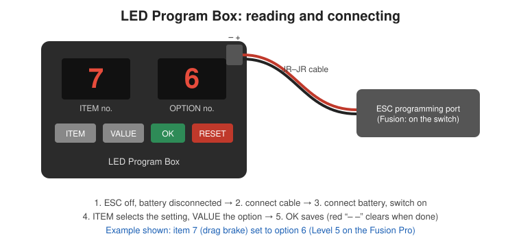
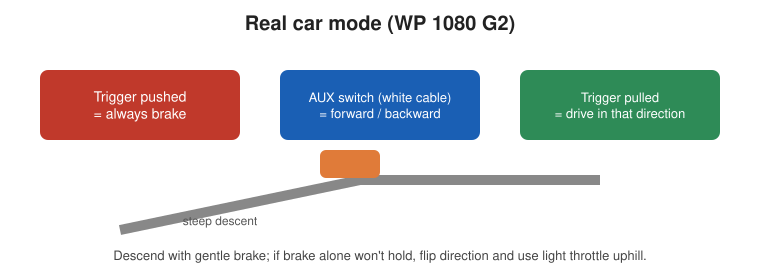
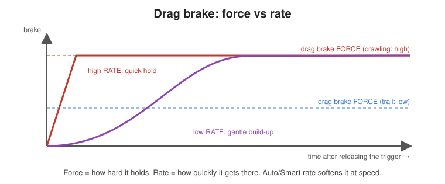
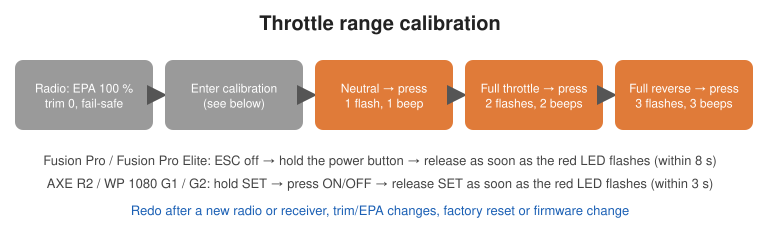

# QuicRun WP 1080 G1 and G2 (brushed crawler ESCs)

Waterproof 80 A brushed ESCs for 1/10 crawlers. The original is sold as **QuicRun WP Crawler Brushed**
(often called the "1080" or "1080 G1"); the **WP 1080 G2** adds a fourth running mode ("real car"),
an 8.4 V BEC option and live drag-brake adjustment.

Programming: **SET button** on the ESC or **LED Program Box/Card** (separate programming port).
See [Programming Tools](programming-tools.md) and [Settings Explained](settings-explained.md).

## G1 vs G2

| | WP Crawler Brushed (G1) | WP 1080 G2 |
|---|---|---|
| Continuous / peak current | 80 A / 400 A | 80 A / 400 A |
| Motors | Brushed 540 / 550 / 775 | Brushed 540 / 550 (775 in the comparison sheet) |
| Motor limit, 2S LiPo / 6S NiMH | ≥ 10T or < 30,000 rpm @ 7.4 V | same |
| Motor limit, 3S LiPo / 9S NiMH | ≥ 16T or < 20,000 rpm @ 7.4 V | same |
| Battery | 2–3S LiPo, 5–9 cell NiMH | same |
| Running modes | 3 | **4** (adds real car mode) |
| BEC | 6.0 / 7.4 V, 3 A (spec table; features list says 4 A/6 A peak) | 6.0 / 7.4 / **8.4 V**, 4 A |
| AUX cables | — | **Yellow** (live drag brake) and **white** (real-car direction) |
| Connectors | XT60 in, no motor connectors | XT60 in, 4.0 mm bullets out |
| Size / weight | 36.2 × 31.6 × 17.0 mm / 58.5 g | 37.2 × 31.9 × 18.4 mm / 70.2 g |
| LED program card in box | Yes | No (sold separately) |

## Programmable items and LED box codes

Same items and numbering on both, except item 1 (G2 has option 4) and item 14 (G2 has 8.4 V).
**Bold** is the factory default. LED code = *item → option*.

| Item | Setting | Options (option number) | Default (LED code) |
|---|---|---|---|
| 1 | Running mode | 1 Forward with Brake · 2 Fwd/Rev with Brake · **3 Forward and Reverse** · 4 Real car (**G2 only**) | 1 → 3 |
| 2 | Battery type | **1 LiPo** · 2 NiMH | 2 → 1 |
| 3 | Cutoff voltage | 1 Disabled · 2 Auto Low (3.0 V/cell; NiMH 4.5 V) · **3 Auto Medium (3.2 V/cell; NiMH 5.0 V)** · 4 Auto High (3.4 V/cell; NiMH 5.5 V) | 3 → 3 |
| 4 | Initial start force | 1 0 % · 2 2 % · **3 4 %** · 4 6 % · 5 8 % · 6 10 % · 7 12 % · 8 14 % · 9 16 % | 4 → 3 |
| 5 | Max. forward force | 1 25 % · 2 50 % · 3 75 % · **4 100 %** | 5 → 4 |
| 6 | Max. reverse force | 1 25 % · **2 50 %** · 3 75 % · 4 100 % | 6 → 2 |
| 7 | Max. brake force | 1 0 % · 2 12.5 % · 3 25 % · 4 37.5 % · 5 50 % · 6 62.5 % · 7 75 % · 8 87.5 % · **9 100 %** | 7 → 9 |
| 8 | Initial brake force | **1 0 %** · 2 6.25 % · 3 12.5 % · 4 18.75 % · 5 25 % · 6 31.25 % · 7 37.5 % · 8 43.75 % · 9 50 % | 8 → 1 |
| 9 | Drag brake | 1 0 % · 2 5 % · 3 10 % · 4 50 % · 5 60 % · 6 70 % · 7 80 % · 8 90 % · **9 100 %** | 9 → 9 |
| 10 | Drag brake rate | 1–9 = Level 1–9, **4 = Level 4** | 10 → 4 |
| 11 | Neutral range | 1 0.02 · 2 0.03 · 3 0.04 · **4 0.05** · 5 0.06 · 6 0.07 · 7 0.08 · 8 0.10 · 9 0.12 ms | 11 → 4 |
| 12 | Start mode / punch | 1–9 = Level 1–9, **5 = Level 5** | 12 → 5 |
| 13 | PWM frequency | 1 1 kHz · 2 2 kHz · 3 4 kHz · **4 8 kHz** · 5 16 kHz | 13 → 4 |
| 14 | BEC voltage | **1 6.0 V** · 2 7.4 V · 3 8.4 V (**G2 only**) | 14 → 1 |
| 15 | Freewheeling | 1 Enabled · **2 Disabled** | 15 → 2 |

Notes from the manuals:
- **Freewheeling:** the manual **recommends Enabled for crawlers** (better low-speed linearity, less
  heat), even though the default is Disabled.
- **Cutoff** on these ESCs cuts output **immediately** at the threshold.
- **PWM frequency:** lower = more aggressive initial acceleration; higher = smoother but more heat.
- **Drag brake** on the G2 can be adjusted live with the **yellow** cable on a spare channel.
- **G1 manual text** describes punch as levels 1–5, but its table (and the G2's) shows 1–9; the LED box
  shows the table's range.

## Real car mode (G2)

- Pushing the trigger **always brakes** — for smooth, controlled descents.
- Plug the **white** cable into a spare channel on a **switch**: the switch flips motor direction, so
  the throttle trigger drives forwards or backwards like a real vehicle's gear selector.
- If brake alone won't hold the truck on a steep slope, flip direction and use gentle throttle against
  the slope.

## Settings: what they do, with trail and crawling recommendations

Each setting, what it does, and starting points for **trail** (scale driving, mixed terrain, some speed) and **crawling** (slow, technical rock work). LED codes are *item → option*. Change one setting at a time and test.

| Item | Setting | What it does | Trail | Crawling |
|---|---|---|---|---|
| 1 | Running mode | Forward and Reverse reverses instantly; Fwd/Rev with Brake needs a double push; Real car (G2) always brakes and uses an AUX switch for direction | **1 → 3**, or **1 → 2** to avoid accidental reverse; **1 → 4** (G2) for scale realism | **1 → 3** Forward and Reverse |
| 2 | Battery type | LiPo or NiMH; sets the cutoff behaviour | **2 → 1** LiPo / **2 → 2** NiMH | Same |
| 3 | Cutoff voltage | Cuts power immediately at the threshold (3.0/3.2/3.4 V per cell) | **3 → 3** Auto Medium | **3 → 3** Auto Medium |
| 4 | Initial start force | Minimum power as soon as you leave neutral; stops the truck rolling back on light throttle | **4 → 2–3** (2–4 %) | **4 → 3–5** (4–8 %) for instant bite on climbs |
| 5 | Max. forward force | Caps full throttle; lower gives finer control | **5 → 3** (75 %) | **5 → 4** (100 %) |
| 6 | Max. reverse force | Caps reverse power | **6 → 2** (50 %) | **6 → 3–4** (75–100 %) |
| 7 | Max. brake force | Strength at full brake | **7 → 7–8** (75–87.5 %) | **7 → 9** (100 %) |
| 8 | Initial brake force | Minimum brake as soon as you enter the brake zone | **8 → 1** (0 %) | **8 → 1** (0 %) |
| 9 | Drag brake | Brake at neutral; 100 % holds the truck on slopes | **9 → 4–6** (50–70 %) to coast a little | **9 → 9** (100 %) |
| 10 | Drag brake rate | How quickly drag brake builds up | **10 → 3–4** | **10 → 4–6** |
| 11 | Neutral range | Dead band around neutral | **11 → 4** (0.05 ms) | **11 → 4**; **5–6** if it creeps |
| 12 | Start mode / punch | How aggressively the motor responds | **12 → 4–6** | **12 → 3–5** less wheel spin |
| 13 | PWM frequency | Motor drive frequency: lower = more aggressive low-speed response; higher = smoother, more heat | **13 → 4–5** (8–16 kHz) smooth | **13 → 2–3** (2–4 kHz) for bite, or **4** (8 kHz) for smoothness |
| 14 | BEC voltage | Voltage to receiver and servo; 7.4/8.4 V only hold on 3S | **14 → 1** 6.0 V | **14 → 2** (or **3** on G2) only for an HV servo on 3S |
| 15 | Freewheeling | Lets the motor freewheel between pulses (DEO): smoother low-speed control, less heat | **15 → 1** Enabled | **15 → 1** Enabled (manual's crawler advice) |

**Real car mode (G2):** **1 → 4**, white cable on a switch channel, drag brake **9 → 8–9**, initial brake **8 → 2–3** for a gentle first brake.

Motor choice matters more than settings on a brushed system: stay within the turn limits above (e.g. no hotter than 16T on 3S).

## Setting up

1. **Motor:** M+/M– have no fixed polarity — swap them if the truck drives backwards.
2. **Receiver:** throttle cable (white/red/black) to the throttle channel; red = BEC power. On the G2,
   yellow to a spare knob channel (drag brake) and/or white to a switch channel (real car mode).
3. **Battery:** observe polarity — reverse polarity **will** damage the ESC.
4. **Calibrate the throttle range** (hold SET, press ON/OFF) — see
   [Programming Tools](programming-tools.md#throttle-calibration-all-of-these-escs).
5. **Program** with the LED card (JR–JR cable to the separate programming port, then switch on) or with
   the SET button:
   - Hold SET while switching on and keep holding for 3 s: the red LED flashes the item number
     (a long flash = 5; long + short = 6…).
   - Release and press SET to step through options (flash count = option number); hold SET 3 s to move
     to the next item. Switch off and on to finish.
6. **Factory reset:** hold SET for over 3 s at neutral, or LED card → **RESET** → **OK**.

## LED codes

| LED | Meaning |
|---|---|
| Red off at neutral | Normal |
| Red flashing driving; solid at full throttle/brake | Normal |
| Red single flash repeating | Low-voltage cutoff |
| Red double flash repeating | ESC overheat |
| Beeps at start: N beeps + long beep | N-cell LiPo; one beep + beep = NiMH mode |

## Sources

- Hobbywing — [QuicRun WP 1080 G2 user manual (Jan 2024)](https://www.hobbywing.com/en/uploads/file/20240229/e4c11442cc2101bb152102f6c72b20fa.pdf); parameter table and defaults read from it
- Asiatees — [QuicRun WP Crawler Brushed (WP 1080 G1) manual](https://www.asiatees.com/files/product/Instruction%20Manual%20QUICRUN%20WP-1080%20Crawler%20Brushed%20ESC.pdf); parameter table and defaults read from it
- Hobbywing Direct — [WP 1080 G2 vs WP Crawler Brushed comparison](https://cdn.shopify.com/s/files/1/0109/9702/files/QuicRun_WP_1080_G2_Specs_comparison_ENs.pdf), [WP G2 leaflet](https://cdn.shopify.com/s/files/1/0109/9702/files/QuicRun_WP_G2__Leafiet_ENs.pdf), [WP 1080 G2](https://hobbywingdirect.com/collections/quicrun-1080-esc-g2)
- Hobbywing — [QuicRun WP 1080 G2 product page](https://www.hobbywing.com/en/products/quicrun-wp-1080-g2267)
- Big Squid RC — [WP 1080 G2 review](https://bigsquidrc.com/hobbywing-quicrun-wp-1080-g2-brushed-esc)
- HobbyKing — [WP Crawler Brushed listing](https://hobbyking.com/en_us/quicrun-wp-crawler-brushed-1.html?wrh_pdp=7)
