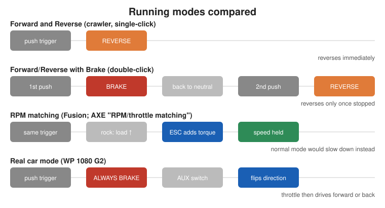
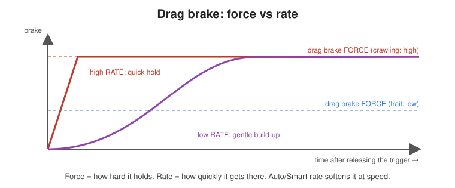

# ESC Settings Explained

What each crawler setting does, in plain terms. Names follow Hobbywing's manuals; not every ESC has
every setting.

## Running mode

| Mode | Behaviour | Use for |
|---|---|---|
| **Forward and Reverse** (crawler mode, "single-click") | Pushing the trigger past neutral reverses **immediately** | Crawling — instant direction changes |
| **Forward/Reverse with Brake** ("double-click", "training") | First push **brakes**; return to neutral and push again to reverse (only once stopped) | Bashing/trail driving where accidental reverse is a problem |
| **Forward with Brake** | No reverse | Racing only — not for crawlers |
| **RPM matching / constant speed** (Fusion Pro, Fusion Pro Elite; AXE R2 "RPM/Throttle Matching") | The ESC holds the **speed** you ask for, adding torque when the load rises (climbing a rock) | Technical crawling — steady, controlled speed |
| **Normal** | Like an ordinary brushless or brushed ESC: speed drops when load rises | Trail/scale driving with a natural feel |
| **Hybrid** (Fusion Pro Elite) | Mode is linked to drag brake: drag brake **Disabled** → Forward/Reverse with Brake; any other drag brake → RPM matching (Hybrid-RPM) or normal Forward and Reverse (Hybrid-Normal) | Switching behaviour on the fly with the drag-brake knob |
| **Real car mode** (WP 1080 G2) | Pushing the trigger always **brakes**; a transmitter switch on the AUX channel flips motor direction | Scale realism; controlled descents |

## Brakes

| Setting | What it does | Tips |
|---|---|---|
| **Drag brake (force)** | Brake applied automatically at neutral | High for crawling (holds on slopes); low for trail coasting. Uses power and makes heat. |
| **Drag brake rate** | How quickly the drag brake builds up to its set value | Low = gentle stop; high = abrupt. Too abrupt can flip the truck at speed. **Auto/Smart** reduces it at speed. |
| **Max. brake force** | Strength at full brake (proportional to trigger) | High stops faster but loads gears |
| **Initial brake force** (WP 1080) | Minimum brake as soon as you enter the brake zone | Usually 0 % or equal to drag brake |

## Throttle feel

| Setting | What it does | Tips |
|---|---|---|
| **Punch / Start mode** | How aggressively the motor starts | Lower for low traction or stuttering starts; higher for snap. High levels need a battery that delivers current quickly. |
| **Initial start force** (WP 1080) | Minimum power as soon as you leave neutral | A few % stops the truck rolling back on a gentle throttle |
| **RPM decrease rate** | How fast RPM drops when you lift off (normal mode only) | Low = coasts like a normal brushless motor; high = slows quickly |
| **Max. forward force** | Caps full throttle | Lower (e.g. 75 %) for slow scale driving and finer trigger control |
| **Max. reverse force** | Caps full reverse | 50–75 % is safer; 100 % for comp crawling |
| **Neutral range** | Dead band around neutral | Increase if the truck creeps or drag brake is inconsistent at neutral |
| **PWM frequency** (WP 1080, brushed) | Motor drive frequency | Lower = more aggressive initial response; higher = smoother but hotter |
| **Freewheeling** (WP 1080) | Lets the motor freewheel between pulses (DEO) | Manual recommends **Enabled** for crawlers: better low-speed linearity, less heat |
| **Turbo timing / delay** (AXE R2) | Extra timing at full throttle | 0° for crawlers; only for speed runs |

## Power and protection

| Setting | What it does | Tips |
|---|---|---|
| **LiPo cells** | Number of cells (or Auto) | Set it manually if you always use the same pack — Auto can mistake a flat 3S for a full 2S |
| **Battery type** (WP 1080) | LiPo or NiMH | Sets the cutoff behaviour |
| **Cutoff voltage** | Low-voltage protection | Medium (≈3.2–3.25 V/cell) for LiPo; **Disabled** for NiMH |
| **Thermal protection** | Temperature where power is cut | Keep 105 °C unless you know why |
| **BEC voltage** | Power to receiver and servo | **Never above the servo's and receiver's rating.** 7.4/8.4 V only holds steady on 3S/4S; on 2S it follows battery voltage |
| **Motor rotation** | Motor direction | Change it if the truck drives backwards on forward throttle |
| **AUX CH function** (Fusion Pro Elite) | Which setting a spare radio channel adjusts live | Default: drag brake on a knob |

## Sources

Hobbywing user manuals for the QuicRun Fusion Pro, Fusion Pro Elite, XeRun AXE R2, and QuicRun WP 1080
G1 and G2 — linked in each product guide.
